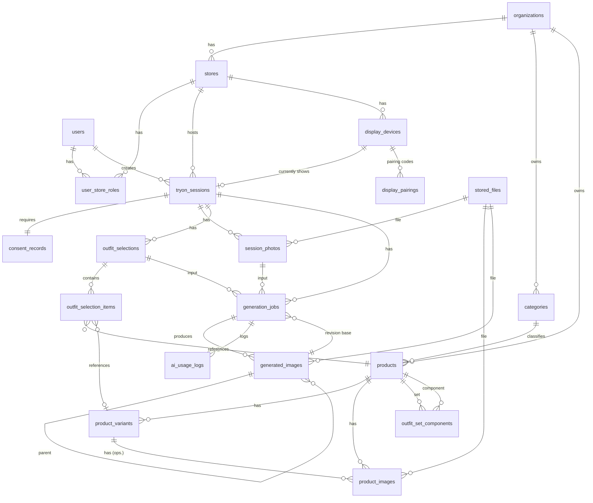

# 03 — Veri Modeli

> **Güncelleme (M4.1):** Veritabanı SQL Server 2025 Express'tir; aşağıdaki tablolar **mantıksal modeldir**, tipler PostgreSQL gösterimiyle yazılmıştır. Gerçek şema: EF Core modeli ve `Migrations/` (tek doğru kaynak). Tip karşılıkları:
>
> | Belgede | SQL Server'da |
> |---|---|
> | `uuid` | `uniqueidentifier` |
> | `timestamptz` | `datetimeoffset` |
> | `text` (enum) | `nvarchar(n)` + CHECK (enum'lar metin; SQL `MAX/ORDER BY` alfabetik olur) |
> | `jsonb`, `uuid[]` | `nvarchar(max)` (JSON metni; EF dönüştürücü / owned) |
> | kısmi indeks `WHERE …` | filtreli indeks (benzersiz indekste `NULL = NULL` sayılır: filtresiz indekste tek NULL) |
> | `SKIP LOCKED` / advisory lock | `UPDLOCK, READPAST` + `OUTPUT` / `sp_getapplock` |
>
> Tenant tutarlılığı bileşik FK ile SQL Server tarafından zorlanır (`UNIQUE (id, organization_id)` + bileşik FK; ayrıntı `CLAUDE.md` M3.4). Güncel durum: `docs/DEVAM-NOTU.md`.

## 1. Genel kurallar

- Birincil anahtarlar: `uuid` (UUIDv7 — zamana göre sıralı, indeks dostu). Tahmin edilemez ID'ler dosya/URL güvenliğine de katkı sağlar.
- Tüm tablolarda `created_at`, `updated_at` (`timestamptz`, UTC).
- Tablo/sütun isimleri `snake_case` (EF Core naming convention).
- **Kiracı izolasyonu:** Kiracıya ait her tabloda `organization_id` zorunlu; şubeye ait olanlarda ayrıca `store_id`. EF Core global query filter aktif kiracıyı otomatik uygular. Ek güvenlik katmanı olarak ileride PostgreSQL Row-Level Security açılabilir.
- **Soft delete** yalnızca katalogda (`is_active` / `archived_at`). Müşteri verisi **gerçekten silinir**.
- Enum'lar veritabanında `text` olarak saklanır (okunabilir, migration'sız genişletilebilir), check constraint ile sınırlanır.
- İkili veri (görsel) veritabanında **tutulmaz**; yalnızca `stored_files` referansı.

## 2. ER diyagramı

## 3. Tablolar

### 3.1 Kiracı ve kullanıcılar

**organizations** — firma (kiracı)

| Sütun | Tip | Not |
|---|---|---|
| id | uuid PK | |
| name | text | |
| slug | text UNIQUE | |
| settings | jsonb | saklama süresi, kota, varsayılan model tercihleri |
| is_active | bool | |

**stores** — şube

| Sütun | Tip | Not |
|---|---|---|
| id | uuid PK | |
| organization_id | uuid FK | |
| name, code | text | `(organization_id, code)` UNIQUE |
| timezone | text | varsayılan `Europe/Istanbul` |
| daily_generation_quota | int NULL | NULL = firma varsayılanı |
| is_active | bool | |

**users** — ASP.NET Core Identity tabloları (`asp_net_users` vb.) + ek alanlar

| Ek sütun | Tip | Not |
|---|---|---|
| organization_id | uuid FK | Kullanıcı tek firmaya aittir |
| display_name | text | |
| pin_hash | text NULL | Ekran kilidi için |
| is_active | bool | |

**user_store_roles**

| Sütun | Tip | Not |
|---|---|---|
| user_id | uuid FK | PK (user_id, store_id) |
| store_id | uuid FK | |
| role | text | `Owner` \| `Manager` \| `Staff` |

> Owner rolü firma genelinde geçerlidir: sorguları basit tutmak için Owner'a her şube için ayrı satır açılır (`store_id` NULL bırakılmaz).

### 3.2 Katalog (firma seviyesi)

**categories**

| Sütun | Tip | Not |
|---|---|---|
| id | uuid PK | |
| organization_id | uuid FK | |
| name | text | "Şalvar" |
| slug | text | `(organization_id, slug)` UNIQUE |
| sort_order | int | Ekranda sıralama |
| body_zone | text | `Upper` \| `Lower` \| `FullBody` \| `Waist` \| `Accessory` |
| layer_order | int | Giyiliş katmanı: gömlek 10, yelek 20, kaftan 30, kemer 40 |
| max_selection | int | Varsayılan 1 |
| conflicts_with | uuid[] | Aynı anda seçilemeyecek kategoriler (ör. bindallı ↔ kaftan) |
| ai_hint | text | Prompt'a eklenecek giyim tarifi ("kemer belde, kaftanın üstünde") — yönetici düzenler, müşteri görmez |
| is_active | bool | |

**products**

| Sütun | Tip | Not |
|---|---|---|
| id | uuid PK | |
| organization_id | uuid FK | |
| category_id | uuid FK | |
| code | text | `(organization_id, code)` UNIQUE |
| name | text | |
| description | text | |
| product_type | text | `Single` \| `OutfitSet` |
| gender_target | text NULL | `Women` \| `Men` \| `Unisex` \| `Kids` (filtre için) |
| layer_order_override | int NULL | Kategoriden farklıysa |
| ai_notes | text NULL | Ürüne özel giyim notu ("şalvar paçası bilekte büzgülü") |
| is_active | bool | |
| archived_at | timestamptz NULL | |

**product_variants** — renk varyantı

| Sütun | Tip | Not |
|---|---|---|
| id | uuid PK | |
| product_id | uuid FK | |
| code | text | `(product_id, code)` UNIQUE |
| color_name | text | "Kırık beyaz" |
| color_hex | char(7) NULL | Renk değişimi hedefi için |
| is_default | bool | Ürün başına tek (partial unique index) |
| is_active | bool | |

**product_images**

| Sütun | Tip | Not |
|---|---|---|
| id | uuid PK | |
| product_id | uuid FK | |
| variant_id | uuid FK NULL | NULL = tüm varyantlar için |
| file_id | uuid FK → stored_files | |
| angle | text | `FRONT` \| `BACK` \| `LEFT` \| `RIGHT` \| `DETAIL` |
| kind | text | `Flat` (düz çekim) \| `OnModel` (manken) \| `Detail` |
| is_ai_reference | bool | Üretimde kullanılacak görsel |
| sort_order | int | |

Kural: aktif bir ürünün aktif her varyantı için en az bir `angle=FRONT, is_ai_reference=true` görsel olmalı (uygulama seviyesinde doğrulanır; yoksa ürün seçilemez).

**outfit_set_components** — hazır takımın bileşenleri (opsiyonel)

| Sütun | Tip | Not |
|---|---|---|
| set_product_id | uuid FK | PK (set, component) |
| component_product_id | uuid FK | |
| component_variant_id | uuid FK NULL | |

> Böylece "takımdaki kemeri değiştir" revizyonu hangi parçanın değiştiğini bilir. Hazır takım yine tek ürün gibi seçilir.

### 3.3 Prova oturumu (şube seviyesi, kişisel veri içerir)

**tryon_sessions**

| Sütun | Tip | Not |
|---|---|---|
| id | uuid PK | |
| organization_id, store_id | uuid FK | |
| created_by_user_id | uuid FK | |
| customer_label | text NULL | Takma ad, en fazla 40 karakter |
| status | text | `Open` \| `Closed` \| `Purged` |
| closed_at | timestamptz NULL | |
| retention_until | timestamptz | Otomatik silme zamanı |
| last_activity_at | timestamptz | |

**consent_records**

| Sütun | Tip | Not |
|---|---|---|
| id | uuid PK | |
| session_id | uuid FK UNIQUE | |
| notice_version | text | Gösterilen aydınlatma metni sürümü |
| processing_consent | bool | Görselin işlenmesi |
| foreign_transfer_consent | bool | Yurt dışı AI sağlayıcısına aktarım |
| extended_retention_consent | bool | 24 saatten uzun saklama |
| guardian_consent | bool NULL | 18 yaş altı |
| method | text | `StaffConfirmedVerbal` \| `CustomerTapped` \| `SignedOnTablet` |
| recorded_by_user_id | uuid FK | |
| recorded_at | timestamptz | |
| withdrawn_at | timestamptz NULL | Geri alınırsa oturum hemen silinir |

> Onay kaydı oturum silinse bile **anonim** halde (session_id hariç, istatistiksel) tutulabilir; KVKK ispat yükümlülüğü için hukuk danışmanıyla netleştirilecek.

**session_photos**

| Sütun | Tip | Not |
|---|---|---|
| id | uuid PK | |
| session_id | uuid FK | |
| file_id | uuid FK | |
| angle | text | `FRONT` (MVP) … |
| width, height | int | |
| quality_flags | jsonb | `{ "blurry": false, "multiplePeople": false, "fullBody": true }` |
| is_primary | bool | |

**outfit_selections** — "Üret"e basıldığı andaki seçim (değişmez kayıt)

| Sütun | Tip | Not |
|---|---|---|
| id | uuid PK | |
| session_id | uuid FK | |
| mode | text | `OutfitSet` \| `FreeCombination` |
| created_by_user_id | uuid FK | |

**outfit_selection_items**

| Sütun | Tip | Not |
|---|---|---|
| id | uuid PK | |
| selection_id | uuid FK | |
| product_id | uuid FK | |
| variant_id | uuid FK NULL | |
| category_id | uuid FK | Ürün kategorisi değişse bile anlık görüntü |
| layer_order | int | Anlık görüntü |

### 3.4 Üretim

**generation_jobs** — hem iş kaydı hem kuyruk

| Sütun | Tip | Not |
|---|---|---|
| id | uuid PK | |
| organization_id, store_id, session_id | uuid FK | |
| job_type | text | `OutfitSet` \| `FreeCombination` \| `Recolor` \| `ProductSwap` \| `VariantPreview` |
| status | text | `Queued` \| `Running` \| `Succeeded` \| `Failed` \| `Cancelled` |
| selection_id | uuid FK NULL | |
| source_photo_id | uuid FK NULL | İlk üretimlerde |
| base_image_id | uuid FK NULL | Revizyonlarda önceki sürüm |
| revision_params | jsonb NULL | `{ "targetCategoryId": "...", "targetColorHex": "#F5F0E6" }` ya da `{ "replaceProductId": "...", "variantId": "..." }` |
| provider | text NULL | Seçilen sağlayıcı (worker yazar) |
| model | text NULL | |
| prompt_template_version | text NULL | |
| provider_request_id | text NULL | FASHN prediction id vb. |
| idempotency_key | text | `(session_id, idempotency_key)` UNIQUE |
| attempt | int | |
| max_attempts | int | Varsayılan 3 |
| next_attempt_at | timestamptz | Kuyruk sırası |
| lease_until | timestamptz NULL | Worker kilidi |
| error_code | text NULL | `ProviderTimeout`, `ContentRejected`, `MaskQualityLow`... |
| error_message | text NULL | Kişisel veri içermez |
| requested_by_user_id | uuid FK | |
| started_at, finished_at | timestamptz NULL | |

İndeks: `(status, next_attempt_at) WHERE status = 'Queued'` (kısmi indeks, kuyruk sorgusu için).

**generated_images** — her sonuç bir sürüm

| Sütun | Tip | Not |
|---|---|---|
| id | uuid PK | |
| session_id | uuid FK | |
| job_id | uuid FK | |
| parent_image_id | uuid FK NULL | Revizyon ağacı |
| version_no | int | Oturum içinde artan (1, 2, 3...) — `(session_id, version_no)` UNIQUE |
| file_id | uuid FK | |
| angle | text | `FRONT` (ileride çok açılı) |
| view_group_id | uuid NULL | Aynı sonucun farklı açıları (360° hazırlığı) |
| label | text | Otomatik: "Bindallı Zümrüt — Bordo", "Şalvar rengi: kırık beyaz" |
| is_color_preview | bool | Katalogda olmayan renk (K3) |
| is_favorite | bool | |

> **RevisionHistory ayrı tablo değildir:** `generated_images.parent_image_id` + `generation_jobs` (tip, parametre, kim, ne zaman) birlikte tam geçmişi verir. Ayrı tablo veri tekrarı olurdu.

**ai_usage_logs**

| Sütun | Tip | Not |
|---|---|---|
| id | uuid PK | |
| organization_id, store_id | uuid FK | |
| job_id | uuid FK NULL | Oturum silinince NULL'a çekilir (ON DELETE SET NULL) — maliyet raporu kalır |
| provider, model, operation | text | |
| attempt | int | |
| success | bool | |
| duration_ms | int | |
| credits_used | numeric NULL | FASHN `x-fashn-credits-used` |
| input_tokens, output_tokens | int NULL | Gemini |
| estimated_cost_usd | numeric(10,4) | |
| actual_cost_usd | numeric(10,4) NULL | Sağlayıcının bildirdiği gerçekleşen kullanım (FASHN kredisi × birim fiyat). Bildirmiyorsa NULL (tahmin geçerli) |
| provider_request_id | text NULL | Sağlayıcı tahmin/etkileşim kimliği (fatura mutabakatı; kişisel veri yok) |
| error_code | text NULL | |
| created_at | timestamptz | |

### 3.5 Smart TV

**display_devices**

| Sütun | Tip | Not |
|---|---|---|
| id | uuid PK | |
| organization_id, store_id | uuid FK | |
| name | text | "Prova Odası 1 TV" |
| token_hash | text | Cihaz kimlik belirtecinin hash'i (SHA-256) — düz hali saklanmaz |
| current_session_id | uuid FK NULL | Şu an bağlı oturum |
| display_state | jsonb | `{ "mode": "single", "imageIds": ["..."] }` — sunucu-otoritatif durum |
| state_version | bigint | Her değişimde artar (eski mesajları elemek için) |
| state_changed_at | timestamptz | Durumun (mod, görseller, bağlı oturum) en son değiştiği an; boşta temizleme bunun üzerinden çalışır. Heartbeat'ler bunu güncellemez |
| last_seen_at | timestamptz | Son heartbeat/bağlantı (`ExecuteUpdate` ile yazılır; sürümü ve `state_changed_at`'ı etkilemez) |
| revoked_at | timestamptz NULL | |

Kısıt: `current_session_id` için UNIQUE (NULL hariç) — bir oturum aynı anda tek TV'de. (Bir oturumu iki TV'de göstermek istenirse kaldırılır — onay sorusu.)

**display_pairings** — geçici kodlar

| Sütun | Tip | Not |
|---|---|---|
| id | uuid PK | |
| code_hash | text | 6 karakterlik kodun hash'i |
| pairing_secret_hash | text | TV tarayıcısında tutulan geçici gizli değer |
| expires_at | timestamptz | 5 dk |
| claimed_device_id | uuid FK NULL | Eşleşince dolar |
| claimed_by_user_id | uuid FK NULL | |
| failed_attempts | int | |

### 3.6 Dosyalar ve denetim

**stored_files**

| Sütun | Tip | Not |
|---|---|---|
| id | uuid PK | |
| organization_id | uuid FK | |
| storage_key | text UNIQUE | |
| content_type | text | |
| size_bytes | bigint | |
| sha256 | char(64) | |
| width, height | int NULL | |
| purpose | text | `CustomerPhoto` \| `GeneratedImage` \| `ProductImage` \| `Mask` |
| retention_until | timestamptz NULL | Katalog için NULL |
| deleted_at | timestamptz NULL | |

**audit_logs**

| Sütun | Tip | Not |
|---|---|---|
| id | bigint identity PK | |
| organization_id, store_id | uuid | |
| user_id / device_id | uuid NULL | |
| action | text | `Session.Created`, `Photo.Uploaded`, `Image.Viewed`, `Display.Assigned`, `Session.Purged`, `Consent.Withdrawn` |
| entity_type, entity_id | text, uuid | |
| ip_hash | text | Ham IP değil |
| created_at | timestamptz | |

## 4. Silme davranışı

- `tryon_sessions` silinince `CASCADE`: consent (anonimleştirilir), photos, selections, jobs, generated_images. `ai_usage_logs.job_id` → `SET NULL`.
- Fiziksel dosyalar önce depodan silinir, sonra kayıt; `RetentionJob` her 15 dakikada `retention_until < now()` olan oturumları temizler ve `audit_logs`'a `Session.Purged` yazar.

## 5. 360° hazırlığı

- `product_images.angle` ve `session_photos.angle` şimdiden var.
- `generated_images.angle` + `view_group_id` aynı sonucun çok açılı çıktılarını gruplar.
- Yeni tablo gerekmeden "FRONT + BACK fotoğraf → FRONT + BACK sonuç" eklenebilir. 3D / tam 360° varsayılmaz.
